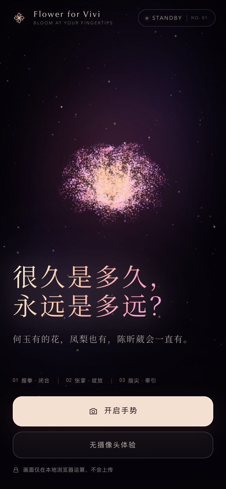
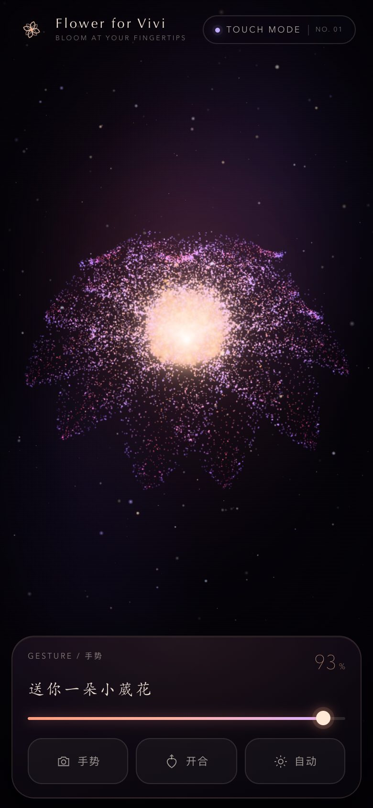
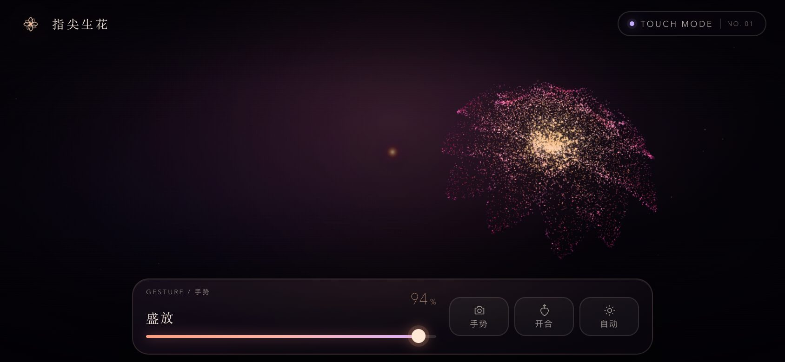
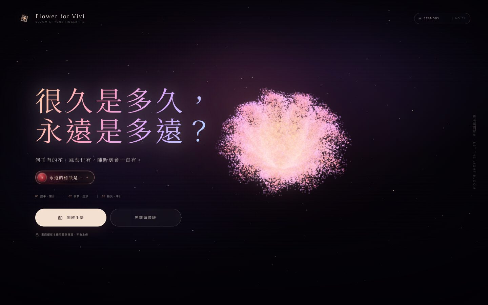

# Flower for Vivi · Bloom at Your Fingertips

一个**为手机重做**的可交互手势粒子花朵：MediaPipe Hands + Three.js + GLSL。

上下拖动画面让花开放或收拢，轻点一下开合；也可以开启前置摄像头，**握拳为苞，张掌绽放**，食指指尖还会牵引光点与附近粒子。

**线上体验：<https://icey777756.github.io/flowerforvivi/>**

<p align="center">
  
  
  
</p>



---

## 交互方式

| 操作 | 效果 |
| --- | --- |
| 在画面上**上下拖动** | 连续控制开合，松手停在当前位置 |
| **轻点画面** | 花苞 ↔ 盛放，一键开合 |
| 拖动底部**滑杆** | 精确设定开合度 |
| 点 **「开合」** | 同上，单手也能按到 |
| 点 **「自动」** | 让花自己缓慢呼吸，点「开合」随时接管 |
| 点 **「手势」** 并允许摄像头 | 握拳收拢，张掌绽放，指尖牵引 |
| 桌面：`Space` / `C` / `A` / `D` | 开合 / 摄像头 / 自动 / 触摸模式 |

摄像头不可用、被拒绝或被占用时，会**自动回落到触摸模式**，不会卡在加载页；应用内浏览器（微信、QQ 等）会提前给出提示。

---

## 手机端做了什么

这次改造不是把桌面版缩小，而是把交互、构图和性能都按手机重做：

- **触控优先**：拖动直接映射开合度（`0.52 × 视口高` 的手势行程），轻点开合，滑杆可拖可键盘，按压反馈 120–160ms，支持时附带轻震动。
- **单手构图**：标题与按钮沉到底部，花朵固定在视口上方 30%–40%，底部控制坞避开 Home Indicator；`100dvh` + `env(safe-area-inset-*)`。
- **屏幕空间锚定**：花朵位置用视口百分比经相机反投影计算，而不是硬编码世界坐标，所以在 320×568 到 1440×900 之间构图一致。
- **横屏适配**：标题移到左侧、花朵移到右侧、控制坞变成横向紧凑布局。
- **性能**：手机粒子数降到 50%、设备像素比上限 1.6、MediaPipe 改用 lite 模型、视频流 960×540；页面隐藏时暂停渲染。
- **原生手感**：移除点击高亮、抑制长按选中与下拉刷新、`touch-action` 区分拖动区与滚动手势、横屏不做字体膨胀。
- **常亮与省电**：进入体验后请求 Wake Lock，页面切后台自动释放并暂停渲染。
- **可安装**：manifest + 192/512/maskable 图标，可「添加到主屏幕」全屏打开。

---

## 本地运行

项目**没有构建步骤**。Three.js、后期处理模块、MediaPipe Hands 模型都已本地化。

```bash
node server.mjs          # 或 npm start
# 打开 http://127.0.0.1:5178/
```

没有 Node.js 时也可以用 `python3 -m http.server 5178`（推荐还是用内置服务器，`.wasm` 的 MIME 更稳）。

> 不要直接双击 `index.html`。摄像头、ES Module 和 WASM 都需要 HTTP(S)。

### 调试用深链

| 链接 | 用途 |
| --- | --- |
| `/?demo=1` | 直接进入触摸模式 |
| `/?auto=1` | 直接进入自动呼吸 |
| `/?camera=1` | 加载后自动请求摄像头（适合展台） |
| `/?intro=0` | 跳过首屏 |

### 手机上打开

摄像头要求 **HTTPS 或 localhost**。要在真机调试，最省事的是直接开线上地址，或者：

```bash
# 同一 Wi-Fi 下用局域网访问（只能体验触摸/自动，摄像头会被浏览器拒绝）
HOST=0.0.0.0 node server.mjs
```

需要真机测试手势时，请用 HTTPS 隧道（如 Cloudflare Tunnel）或直接使用 GitHub Pages 地址。

---

## 部署到 GitHub Pages

本仓库就是可发布的静态站点，根目录已带 `.nojekyll`。

1. 推送到 `main`。
2. 仓库 **Settings → Pages → Build and deployment**：Source 选 *Deploy from a branch*，Branch 选 `main` / `(root)`。
3. 等待约 1 分钟，访问 `https://<用户名>.github.io/<仓库名>/`。

也可以用命令行：

```bash
gh api -X POST repos/<owner>/<repo>/pages \
  -f "source[branch]=main" -f "source[path]=/"
```

或者直接运行仓库里的 `bash 发布到GitHub.sh`：它会检查 `gh` 登录、创建仓库、推送，并自动开启 Pages。

> GitHub Pages 走 HTTPS，手机浏览器因此允许摄像头；`.wasm` 即使被返回为 `application/octet-stream`，MediaPipe 也会自动回退到 ArrayBuffer 加载。

---

## 目录结构

```text
flowerforvivi/
├── index.html               # 页面结构、meta、import map
├── manifest.webmanifest     # PWA 清单
├── assets/                  # 应用图标（SVG + PNG）
├── src/
│   ├── main.js              # 模式、触摸/滑杆/按钮、HUD、相机流程
│   ├── flower.js            # Three.js 场景、粒子花朵、GLSL、后期
│   ├── hand-tracker.js      # MediaPipe 初始化、摄像头、手势评分
│   ├── hand-overlay.js      # 2D 手部骨架绘制
│   └── styles.css           # 移动优先样式与响应式断点
├── mediapipe/hands/         # 本地 MediaPipe Hands JS / WASM / 模型
├── vendor/three/            # Three.js 与后期处理模块
├── docs/                    # README 预览图
├── licenses/                # 第三方许可
├── THIRD_PARTY_NOTICES.md
├── 修改指南.md               # 想改参数看这里
├── 访问通知设置.md            # 可选：Server酱微信访问通知
└── server.mjs               # 零依赖静态服务器
```

---

## 手势识别

MediaPipe Hands 返回每只手 21 个归一化关键点，`analyzeHand()` 会计算：

1. 以腕—中指根长度与食指根—小指根宽度加权得到的**掌部尺度**，抵消手离镜头远近的影响。
2. 每根手指的**伸展度**：指尖到指根的距离 + 近节指骨处的关节直角度。
3. **拇指伸展度**：用拇指尖到食指根的距离补足活动轴向。
4. 加权求和并做时间指数平滑，避免 HUD 与花朵抖动。
5. 分类：`< 0.24` 花苞，`0.24–0.62` 舒展，`> 0.62` 盛放。

手部短暂丢失时有约 180–380ms 的容忍时间；手机端使用 lite 模型（`modelComplexity: 0`）以换取帧率。

---

## 视觉实现

- `src/flower.js`
  - 确定性随机生成四层共 32 片花瓣的粒子，保存 `position`（开放）与 `aBudPosition`（花苞）两套坐标。
  - 顶点着色器完成逐粒子延迟展开、螺旋旋转、呼吸浮动、光爆、指尖吸引与点精灵尺寸。
  - `EffectComposer + UnrealBloomPass + OutputPass` 泛光与 Neutral Tone Mapping。
  - 粒子点尺寸跟随视口高度归一化，短屏/横屏不会因叠加过密而糊成一片白光。
- `src/main.js`
  - 触摸拖动 → 开合度映射；速度阻尼「张开快、收拢慢」。
  - 模式编排：首屏 / 触摸 / 自动 / 摄像头手势。
- `src/hand-overlay.js`
  - 镜像手部骨架、节点、指尖环与掌心光晕，和 `object-fit: cover` 的预览同步裁切。

---

## 性能与兼容

- 需要 WebGL 2、ES Modules + Import Maps、`getUserMedia`、WebAssembly（SIMD 更佳）。
- 推荐最新版 iOS Safari / Chrome / Edge。iOS 16.4+ 的 Safari 支持 WASM SIMD。
- 不支持 WebGL 时显示明确的提示卡片，而不是空白画布。
- 首次开启手势会下载约 12 MB 的手部模型（仅一次），加载页会提示。

---

## 隐私

- 摄像头画面只在浏览器内做 MediaPipe 推理，**不会上传**。
- 没有广告或行为统计脚本、追踪像素或外部字体请求；字体、模型与 Three.js 全部本地加载。
- 访问通知（已启用）：页面加载时会向 `ipapi.co` / `get.geojs.io` 查询访客的国家/省/市，再向 Server酱 发送一次时间、页面、来源、设备、屏幕、语言与城市；不含摄像头画面，不设置 Cookie，20 秒内重复刷新只记一次，DNT 用户不发送。第三方 IP 服务会看到访客 IP，本站不保存 IP。说明见 [`访问通知设置.md`](访问通知设置.md)。
- 再次点击「手势」会立即停止所有视频轨道并切回触摸模式。

---

## 常见问题

**手机点了「开启手势」没反应 / 提示权限未开启**

- 必须是 `https://` 或 `localhost`，局域网 `http://192.168.x.x` 会被浏览器拒绝。
- iOS 需要在弹窗里允许摄像头；Safari 设置里若禁止了相机也会失败。
- 微信 / QQ / 微博等内置浏览器通常不允许网页调用摄像头，请点右上角「···」用系统浏览器打开。

**加载很久**

首次会下载约 12 MB 模型；之后走浏览器缓存。网络差时建议先用「无摄像头体验」。

**手势识别抖动**

让手掌完整进入画面、正面朝向镜头，距离 40–80cm，光线不要太暗。

---

## 第三方资源

- [Three.js](https://threejs.org/) r186.1 — MIT
- [MediaPipe Hands](https://developers.google.com/mediapipe/solutions/vision/hand_landmarker) 0.4.1675469240 — Apache License 2.0
- [Noto Serif SC](https://github.com/notofonts/noto-cjk)（自托管子集，37 KB）— SIL Open Font License 1.1

详细许可文本见 [`THIRD_PARTY_NOTICES.md`](THIRD_PARTY_NOTICES.md) 与 [`licenses/`](licenses/)。

---

想改花瓣层数、配色、手势阈值、构图位置？看 [`修改指南.md`](修改指南.md)。
